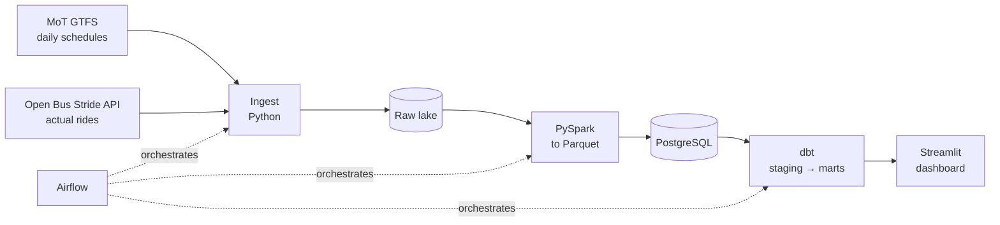

cat > README.md << 'README_EOF'
# Israel Public Transport Data Pipeline


An end-to-end data pipeline that compares **planned** Israeli public transport schedules with **actual** bus rides, to measure delays and reliability by line, operator, city and hour.

> 🚧 **Work in progress.** See the [roadmap](#roadmap) for what's done and what's next.

## Architecture (planned)



**Stage 1** runs locally with Docker Compose. **Stage 2** moves storage to Azure Data Lake Storage and the warehouse to Azure SQL.

## Data sources

| Source | What it provides | Access |
|---|---|---|
| [Ministry of Transport GTFS](https://www.gov.il/he/pages/gtfs_general_transit_feed_specifications) | Planned schedules for all public transport in Israel | Public download, subject to the Ministry's terms of use |
| [Open Bus Stride API](https://open-bus-stride-api.hasadna.org.il/docs) by [The Public Knowledge Workshop](https://www.hasadna.org.il/) | Actual bus rides, collected from the Ministry's real-time SIRI feed | Public REST API |

Raw data files are not stored in this repository.

## Tech stack

| Area | Tools | Status |
|---|---|---|
| Language & packaging | Python 3.12, Poetry | ✅ |
| Configuration | pydantic-settings (typed, env-based) | ✅ |
| Logging | Structured JSON logs | ✅ |
| Database | PostgreSQL 16 (Docker) | ✅ |
| Quality | pytest, mypy (strict), ruff | ✅ |
| CI | GitHub Actions | ✅ |
| Processing | PySpark | planned |
| Orchestration | Apache Airflow | planned |
| Modeling & tests | dbt | planned |
| Dashboard | Streamlit | planned |
| Cloud | Azure Data Lake Storage, Azure SQL, Databricks | planned |

## Running locally

Requirements: Docker, Python 3.12, Poetry.

```bash
# 1. Configure
cp .env.example .env        # then set your own POSTGRES_PASSWORD

# 2. Start the database
docker compose up -d

# 3. Install and run the checks
poetry install
poetry run ruff check .
poetry run mypy src tests
poetry run pytest
```

## Roadmap

- [x] Project setup: Poetry, Docker Compose, PostgreSQL
- [x] Typed configuration and structured JSON logging, with tests
- [x] CI: lint, type check and tests on every pull request
- [ ] Explore the GTFS data
- [ ] GTFS ingestion with raw history
- [ ] PySpark conversion to Parquet
- [ ] Airflow orchestration
- [ ] Real-time ride ingestion from Stride
- [ ] dbt models: staging, intermediate, marts, with tests
- [ ] Delay and reliability metrics
- [ ] Streamlit dashboard
- [ ] Migration to Azure
- [ ] Databricks showcase

## Project structure